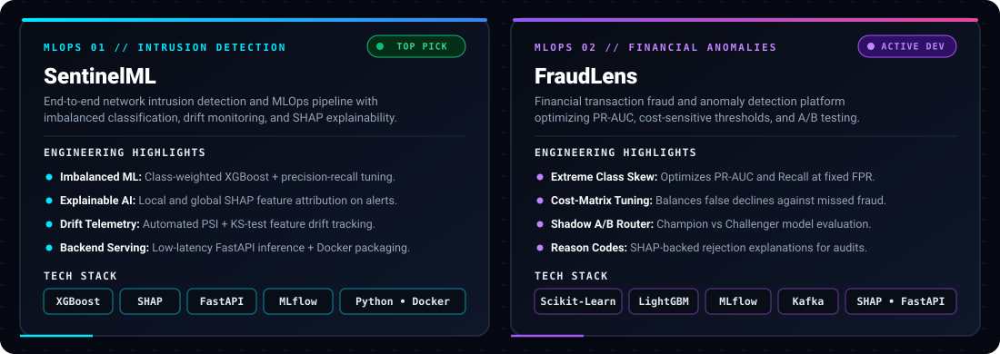
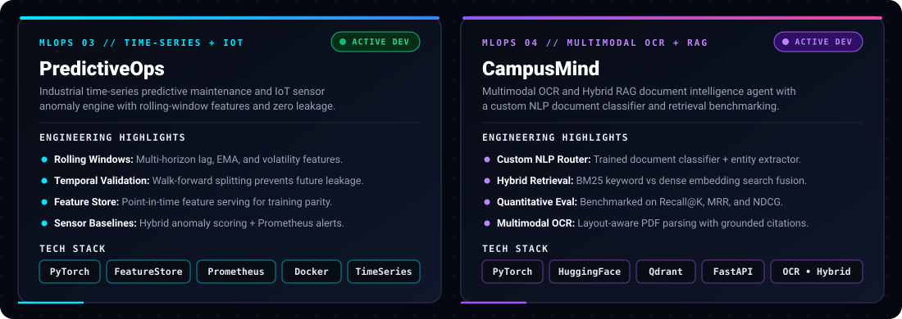
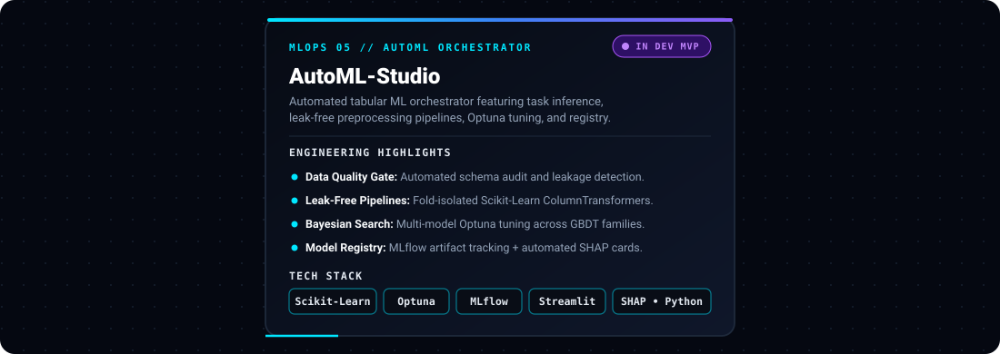
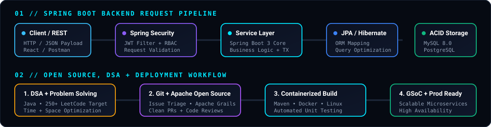

<!-- ===================================================== -->
<!--              ANIMATED HERO SECTION v5                 -->
<!-- ===================================================== -->

  

  

<!-- Recruiter & Open Source Action Links -->

  
  
  
  
  

<!-- Fixed Live Telemetry Badges -->

  
  
  

  

<!-- ===================================================== -->
<!--                    ABOUT ME v5                        -->
<!-- ===================================================== -->

# 👋 About Me

<table>
<tr>
<td width="60%" valign="top">
  

  

  
</td>
<td width="40%" valign="top">
  

  
  
  
</td>
</tr>
</table>

# 🚀 Featured Engineering Projects

<!-- LINE 3: Student Marks Manager + Metadata Extractor (2 Projects + 2 Repo Buttons) -->

  

  
  &nbsp;&nbsp;&nbsp;&nbsp;
  

<!-- LINE 1: SentinelML + FraudLens (2 Projects + 2 Repo Buttons) -->

  

  
  &nbsp;&nbsp;&nbsp;&nbsp;
  

<!-- LINE 2: PredictiveOps + CampusMind (2 Projects + 2 Repo Buttons) -->

  

  
  &nbsp;&nbsp;&nbsp;&nbsp;
  

<!-- LINE 4: AutoML-Studio (1 Centered Project + 1 Repo Button) -->

  

  

# 🛠️ Tech Stack & Tooling

  

  

  

# 🏗️ My Backend Architecture & Engineering Pipeline

  

---

# 📊 Telemetry & Contribution Activity

<!-- Row 2: 3 Summary Cards in a Single Symmetrical Row (32.5% each) -->

  
  
  

 

<!-- Row 3: GitHub Streak (49%) + Live LeetCode Heatmap (49%) Side-by-Side -->

  

  
---

<h2 align="center">🚀 CONTRIBUTION SHOOTER</h2>

  

---

# 🤝 Let's Connect & Build Together

  
  
  

  

