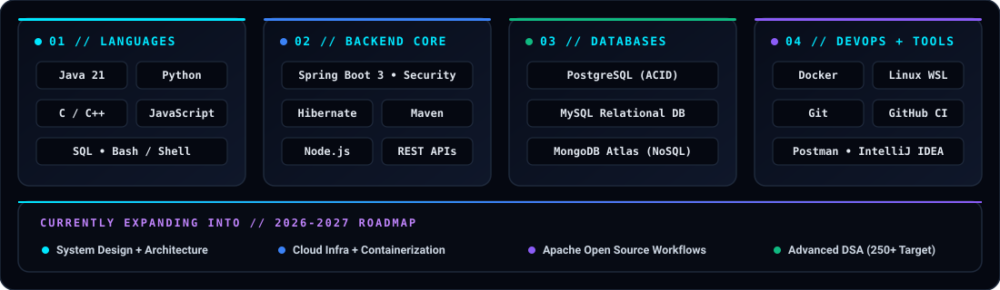
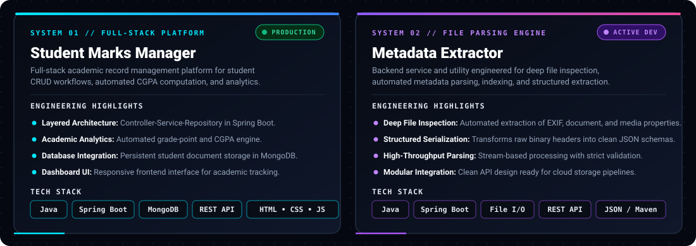

<!-- ===================================================== -->
<!--              ANIMATED HERO SECTION v5                 -->
<!-- ===================================================== -->

  

  

<!-- Recruiter & Open Source Action Links -->

  
  
  
  

<!-- Fixed Live Telemetry Badges -->

  
  
  

  

<!-- ===================================================== -->
<!--                    ABOUT ME v5                        -->
<!-- ===================================================== -->

# 👋 About Me

<table>
<tr>
<td width="60%" valign="top">
  
</td>
<td width="40%" valign="top">
  
  
  
</td>
</tr>
</table>

# 🏗️ My Backend Architecture & Engineering Pipeline

  

# 🛠️ Tech Stack & Tooling

  

  

# 🚀 Featured Engineering Projects

  

<!-- Clickable Repository Buttons for the 2 SVG Cards -->

  
  &nbsp;&nbsp;&nbsp;&nbsp;
  

---

# 📊 GitHub Telemetry & Contribution Activity

  

  

  

---

# 🐍 Contribution Snake

<picture>

<source media="(prefers-color-scheme: dark)"
srcset="https://raw.githubusercontent.com/Aditya70-creator/Aditya70-creator/output/github-contribution-grid-snake-dark.svg"/>

<source media="(prefers-color-scheme: light)"
srcset="https://raw.githubusercontent.com/Aditya70-creator/Aditya70-creator/output/github-contribution-grid-snake.svg"/>

</picture>

# 🤝 Let's Connect & Build Together

Open to **Backend Engineering Internships**, **Open Source Collaborations**, and discussions around **Java, Spring Boot, System Design, and Distributed Systems**.

 

  

  

